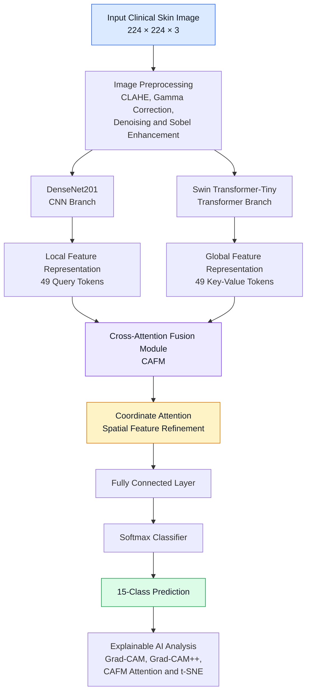

# BDS-CAFNet
### DenseNet–Swin Cross-Attention Fusion Network for Explainable Multi-Class Skin Disease Classification

<p align="center">
  <strong>An Explainable Hybrid CNN–Transformer Framework for Dermatological Image Classification</strong>
</p>

<p align="center">
  
</p>

<p align="center">
  
  
  
  
  
</p>

---

## Overview

Skin diseases present significant diagnostic challenges due to visual similarities between different conditions and limited access to dermatological expertise in resource-constrained healthcare settings.

To address these challenges, this research introduces **BDS-CAFNet (DenseNet–Swin Cross-Attention Fusion Network)**, an explainable hybrid deep learning framework designed for multi-class skin disease classification using primary clinical dermatological images collected in Bangladesh.

The proposed architecture combines the local feature extraction capabilities of **DenseNet201** with the global contextual modelling capabilities of **Swin Transformer-Tiny**. A custom **Cross-Attention Fusion Module (CAFM)** dynamically integrates the complementary feature representations, followed by **Coordinate Attention (CA)** to refine spatially informative features before final classification.

The framework also incorporates multiple Explainable Artificial Intelligence (XAI) techniques to investigate the visual regions contributing to model predictions.

### Key Highlights

- Hybrid dual-branch architecture integrating DenseNet201 and Swin Transformer-Tiny.
- Custom Cross-Attention Fusion Module for adaptive local-global feature integration.
- Coordinate Attention for spatially aware feature refinement.
- Primary clinical dataset comprising 1,850 images from 210 consenting patients.
- Multi-class classification across 15 dermatological categories.
- Clinically motivated preprocessing and partition-wise data augmentation.
- Hybrid Focal–Dice loss and two-phase discriminative fine-tuning.
- Multi-level explainability using Grad-CAM, Grad-CAM++, CAFM attention maps and t-SNE.
- Evaluation using held-out testing and stratified five-fold cross-validation.

---

## Research Performance

<p align="center">
  
  
  
</p>

| Evaluation Metric | Reported Performance |
|:---|---:|
| Test Accuracy | **97.87%** |
| Macro Precision | 97.97% |
| Macro Recall | 97.87% |
| Macro F1-Score | **97.86%** |
| Macro ROC-AUC | **0.9998** |
| Five-Fold Mean Accuracy | **99.04% ± 0.39%** |
| Five-Fold Mean Macro AUC | 0.9998 |

*Results are reported from the experimental evaluation described in the thesis. Five-fold cross-validation results are reported separately from the held-out test results.*

---

## Proposed Architecture

### BDS-CAFNet: Hybrid Dual-Branch Framework

The proposed network processes a preprocessed dermatological image through two parallel feature extraction branches.

- **DenseNet201:** Extracts fine-grained local features, including lesion texture, colour variations and edge characteristics.
- **Swin Transformer-Tiny:** Learns global contextual information and spatial relationships through shifted-window self-attention.
- **CAFM:** Integrates local and global representations through multi-head cross-attention.
- **Coordinate Attention:** Refines the fused representation while preserving spatial information.
- **Classifier:** Produces the final probability distribution over 15 dermatological categories.

### Architecture Workflow



<p align="center">
  
</p>

### 1. DenseNet201 Branch

DenseNet201 serves as the convolutional feature extraction backbone.

Its dense connectivity pattern facilitates feature reuse and supports the extraction of detailed local information.

The branch focuses on:

- Fine-grained lesion texture.
- Colour and appearance variations.
- Local boundaries and structural patterns.
- Discriminative visual characteristics.

### 2. Swin Transformer Branch

Swin Transformer-Tiny operates in parallel with DenseNet201.

Its shifted-window self-attention mechanism captures spatial relationships and contextual information that may not be fully represented by conventional convolutional operations.

The branch focuses on:

- Global lesion distribution.
- Spatial relationships.
- Contextual feature dependencies.
- Broader visual patterns.

### 3. Cross-Attention Fusion Module (CAFM)

CAFM is the central feature-integration component of BDS-CAFNet.

Instead of simply concatenating the two feature representations, the module performs cross-attention to establish adaptive interactions between local CNN features and global Transformer features.

The attention mechanism is formulated as:

\[
\operatorname{Attention}(Q,K,V)
=
\operatorname{Softmax}
\left(
\frac{QK^T}{\sqrt{d_k}}
\right)V
\]

Where:

- **Q (Query):** DenseNet201 local feature tokens.
- **K (Key):** Swin Transformer global feature tokens.
- **V (Value):** Swin Transformer global feature tokens.
- \(d_k\): Key dimension.

The implementation performs a 49 × 49 cross-attention operation per image, using 49 CNN query tokens and 49 Transformer key-value tokens.

This allows local lesion features to selectively incorporate relevant global contextual information.

### 4. Coordinate Attention

Following cross-attention fusion, Coordinate Attention refines the fused feature representation.

It incorporates directional spatial information along the horizontal and vertical dimensions, helping the network preserve location-sensitive information while improving feature discrimination.

### 5. Classification Head

The refined feature representation is passed through the fully connected classification layer and Softmax activation to generate probabilities for the 15 target categories.

---

## Dataset Description

The proposed framework was developed using a primary clinical dermatological image dataset collected in Bangladesh.

| Dataset Information | Description |
|:---|:---|
| Original Images | 1,850 |
| Patients | 210 consenting patients |
| Disease Categories | 15 |
| Input Resolution | 224 × 224 × 3 |
| Dataset Source | Bangladesh Institute of Dermatology, STD and AIDS |
| Dataset Type | Primary Clinical Images |

### Dataset Splitting

The original images were stratified into training, validation and testing partitions before augmentation to reduce the risk of data leakage between partitions.

| Partition | Split | Balanced Images | Images per Class |
|:---|---:|---:|---:|
| Training | 80% | 6,000 | 400 |
| Validation | 10% | 750 | 50 |
| Testing | 10% | 750 | 50 |
| **Total** | **100%** | **7,500** | **500** |

### Data Augmentation

Class-wise augmentation was applied independently within each partition to achieve balanced class distributions.

The augmentation strategy included:

- Horizontal flipping.
- Bounded rotation.
- Translation.
- Brightness adjustment.

The original partition assignments were maintained during augmentation.

**Important:** The 7,500 images represent the balanced augmented experimental dataset, not 7,500 independently collected clinical images.

### Dataset Privacy

The original clinical dataset is not included in this public repository because of patient privacy and clinical data governance considerations.

Dataset access and redistribution require appropriate institutional authorization.

See [`data/README.md`](data/README.md) for additional information.

---

## Image Preprocessing

A quality-conscious preprocessing pipeline was adopted to improve image consistency and preserve diagnostically relevant visual information.

### Preprocessing Operations

| Operation | Purpose |
|:---|:---|
| CLAHE | Local contrast enhancement |
| Gamma Correction | Illumination adjustment |
| Non-Local Means Denoising | Noise reduction |
| Sobel Edge Detection | Lesion boundary enhancement |
| Image Resizing | Standardization to 224 × 224 |
| ImageNet Normalization | Input normalization |

The Sobel edge representation is combined with the original image to provide edge-enhanced input information.

<p align="center">
  
</p>

---

## Training Methodology

BDS-CAFNet was optimized using a two-phase transfer learning strategy.

### Phase 1: Frozen Warm-Up

The initial phase focuses on training newly introduced fusion and classification components while preserving the pretrained backbone representations according to the defined freezing policy.

- Duration: 10 epochs.
- Learning rate: 1 × 10⁻⁴.
- Best validation macro F1-score: 0.9285.

### Phase 2: Discriminative Fine-Tuning

The second phase introduces discriminative fine-tuning with separate learning rates for pretrained backbones and newly introduced modules.

- Backbone learning rate: 1 × 10⁻⁵.
- New module learning rate: 1 × 10⁻⁴.
- Early stopping based on validation macro F1-score.
- Best validation macro F1-score: 0.9960 at epoch 16.

### Training Configuration

| Hyperparameter | Configuration |
|:---|:---|
| Deep Learning Framework | PyTorch 2.10.0 |
| GPU Platform | Kaggle |
| GPU | NVIDIA Tesla T4 (16 GB) |
| CUDA | 12.8 |
| Input Resolution | 224 × 224 × 3 |
| Batch Size | 16 |
| Random Seed | 42 |
| Optimizer | AdamW |
| Weight Decay | 0.05 |
| Learning Rate Scheduler | CosineAnnealingLR |
| Minimum Learning Rate | 1 × 10⁻⁶ |
| Loss Function | 0.6 Focal + 0.4 Dice |
| Focal Loss Gamma | 2.0 |
| Focal Loss Alpha | 0.25 |
| Gradient Clipping | 1.0 |
| Early Stopping Patience | 8 |
| Training Duration | Approximately 52 minutes |

### Computational Complexity

| Metric | Value |
|:---|---:|
| Total Parameters | 49,416,491 |
| Trainable Parameters | 46,046,889 |
| Frozen Parameters | 3,369,602 |
| Computational Cost | 8.87 GMACs |
| FLOPs | 17.75 GFLOPs |

The complete training process was conducted in approximately 52 minutes under the reported single-GPU experimental environment.

---

## Experimental Results

### Baseline Model Comparison

The proposed framework was compared against standalone CNN and Transformer architectures.

| Model | Test Accuracy |
|:---|---:|
| **BDS-CAFNet** | **97.87%** |
| DenseNet201 | 95.73% |
| Swin Transformer | 94.27% |

The proposed hybrid architecture achieved higher test accuracy than its two standalone backbone counterparts in the reported experiments.

### Test Performance Visualization

<p align="center">
  
</p>

<p align="center">
  <em>Confusion matrix on the held-out test set.</em>
</p>

<p align="center">
  
</p>

<p align="center">
  <em>Multi-class ROC analysis with a macro-average AUC of 0.9998.</em>
</p>

### Five-Fold Cross-Validation

Stratified five-fold cross-validation was conducted to evaluate performance across different data partitions.

| Metric | Result |
|:---|---:|
| Mean Accuracy | 99.04% |
| Standard Deviation | ±0.39% |
| Mean Macro AUC | 0.9998 |

These results are reported separately from the held-out test evaluation.

---

## Explainable Artificial Intelligence (XAI)

Model interpretability is an important component of the proposed framework.

Multiple complementary visualization techniques were used to investigate the learned representations and identify the visual regions contributing to predictions.

### 1. Grad-CAM

Grad-CAM provides gradient-based visual explanations by highlighting image regions associated with class predictions.

### 2. Grad-CAM++

Grad-CAM++ provides a complementary gradient-based localization approach for investigating class-discriminative regions.

### 3. CAFM Attention Visualization

CAFM attention maps visualize interactions between local CNN query tokens and global Transformer key-value tokens.

### 4. t-SNE Visualization

t-SNE is used to visualize the distribution and separation of learned feature representations.

### Explainability Results

<p align="center">
  
</p>
<p align="center"><em>DenseNet201 branch visualization.</em></p>

<p align="center">
  
</p>
<p align="center"><em>Swin Transformer branch visualization.</em></p>

<p align="center">
  
</p>
<p align="center"><em>Fused BDS-CAFNet Grad-CAM++ visualization.</em></p>

<p align="center">
  
</p>
<p align="center"><em>Cross-attention visualization.</em></p>

<p align="center">
  
</p>
<p align="center"><em>Learned feature-space visualization.</em></p>

---

## Repository Structure

```text
BDS-CAFNet/
│
├── README.md
├── LICENSE
├── CITATION.cff
├── requirements.txt
├── .gitignore
│
├── configs/
│   ├── config.yaml
│   └── class_names.json
│
├── data/
│   ├── README.md
│   └── sample_images/
│
├── notebooks/
│   ├── 01_data_exploration.ipynb
│   ├── 02_image_preprocessing.ipynb
│   ├── 03_data_augmentation.ipynb
│   ├── 04_baseline_experiments.ipynb
│   ├── 05_bds_cafnet_training.ipynb
│   ├── 06_model_evaluation.ipynb
│   └── 07_explainable_ai.ipynb
│
├── src/
│   ├── models/
│   │   ├── densenet_branch.py
│   │   ├── swin_branch.py
│   │   ├── cafm.py
│   │   ├── coordinate_attention.py
│   │   └── bds_cafnet.py
│   │
│   ├── preprocessing/
│   ├── training/
│   ├── evaluation/
│   └── explainability/
│
├── checkpoints/
│   └── README.md
│
├── results/
│   ├── figures/
│   ├── confusion_matrix/
│   ├── roc_curves/
│   └── explainability/
│
├── deployment/
│   ├── app.py
│   ├── templates/
│   └── static/
│
├── docs/
│   ├── architecture.svg
│   └── assets/
│
└── tests/
    └── test_model.py
```

*The directory tree represents the recommended repository organization. Directory and file names should be adjusted to match the actual uploaded implementation.*

---

## Installation

### 1. Clone the Repository

```bash
git clone https://github.com/YOUR_USERNAME/BDS-CAFNet.git

cd BDS-CAFNet
```

### 2. Create a Virtual Environment

```bash
python -m venv venv
```

Activate the environment:

**Windows**

```bash
venv\Scripts\activate
```

**Linux / macOS**

```bash
source venv/bin/activate
```

### 3. Install Dependencies

```bash
pip install -r requirements.txt
```

Make sure the installed PyTorch and CUDA versions are compatible with your hardware.

### 4. Prepare the Dataset

Place the authorized dataset in the expected directory structure and update the configuration paths.

```text
data/
├── train/
├── validation/
└── test/
```

The original clinical images are not distributed with this repository.

### 5. Run the Model

```bash
python -m src.training.train
```

*The command assumes the training entry point is organized as shown in the recommended repository structure. Update it to match the actual implementation.*

### 6. Evaluate the Model

```bash
python -m src.evaluation.evaluate
```

### 7. Run the Deployment Application

```bash
python deployment/app.py
```

*Deployment commands require the corresponding application files and an authorized trained checkpoint.*

---

## Model Checkpoints

Pretrained model weights are not included by default because of repository size considerations.

If authorized weights are made available, they can be placed in:

```text
checkpoints/
└── bds_cafnet_best.pth
```

For larger checkpoints, Git LFS or GitHub Releases can be used.

---

## Reproducibility

The following experimental settings were used to support reproducibility:

- Fixed random seed of 42.
- Stratified original-image partitioning.
- Partition-wise augmentation.
- ImageNet-pretrained backbones.
- Two-phase training.
- Automatic mixed-precision training.
- Validation-based early stopping.
- Best validation checkpoint restoration.

Exact reproduction also requires access to the authorized original dataset, the corresponding preprocessing implementation, pretrained backbone weights and compatible software dependencies.

---

## Limitations

Although BDS-CAFNet achieved promising experimental results, several limitations should be considered:

- The primary dataset contains 1,850 original images from 210 patients.
- The dataset represents 15 dermatological categories and may not cover the full diversity of skin conditions.
- Performance on external institutions and populations has not been established by the reported experiments.
- Cross-attention visualization can exhibit concentrated attention patterns, requiring further analysis.
- Explainability maps provide visual evidence of model behaviour but do not independently establish clinical validity.

Further external validation and broader clinical evaluation are necessary before considering real-world clinical use.

---

## Ethical Considerations and Medical Disclaimer

This project is intended for academic research and experimental evaluation in dermatological image classification.

The original clinical images were obtained from consenting patients under the research process described in the thesis.

Patient privacy and institutional data-sharing requirements must be respected when accessing, processing or distributing clinical images.

**BDS-CAFNet is not a substitute for professional medical diagnosis, dermatological examination or clinical decision-making.** Its predictions should not be used as the sole basis for treatment or medical decisions.

---

## Citation

If you use this work in academic research, please cite the original thesis.

**Authors:** Md. Maruf Kadir and Mehedi Hasan Rafi  
**Department:** Computer Science and Engineering  
**Institution:** Daffodil International University, Bangladesh

```bibtex
@thesis{kadir2026bdscafnet,
  author = {Kadir, Md. Maruf and Rafi, Mehedi Hasan},
  title = {BDS-CAFNet: DenseNet-Swin Cross-Attention Fusion Network for Skin Disease Classification},
  school = {Daffodil International University},
  year = {2026},
  type = {Undergraduate Thesis}
}
```

*Verify the official thesis title and year against the final institutional submission before publication.*

---

## Acknowledgements

We express our sincere gratitude to our research supervisor, faculty members and the clinical contributors who supported this research.

We also acknowledge the Bangladesh Institute of Dermatology, STD and AIDS, for its role in the clinical data collection process described in this work.

---

## Authors

**Md. Maruf Kadir**  
Department of Computer Science and Engineering  
Daffodil International University, Bangladesh

**Mehedi Hasan Rafi**  
Department of Computer Science and Engineering  
Daffodil International University, Bangladesh

---

<p align="center">
  <strong>BDS-CAFNet</strong>
  <br>
  <em>Bridging Local and Global Features for Explainable Dermatological Image Classification.</em>
</p>
